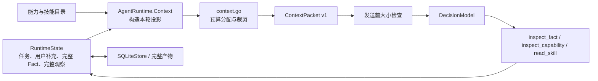

# 上下文管理：预算、投影与恢复

Agenstra 完整保存运行状态，每轮构造有界模型视图，并通过检查决策按需读取细节。上下文预算由 `internal/runtime/react/context.go` 与 `AgentRuntime.Context()` / `Step()` 分配。跨运行记忆由 Host 和 SQLite 管理，并共享上下文预算；学习规则、宿主管理接口、快照失效与保留边界见[记忆设计与宿主管理](memory-management.md)。

## 1. 框架中的职责分配



`RuntimeState` 和完整 Fact 是执行、审计及恢复的依据。`ContextPacket` 是本轮模型视图：构建它不删除、改写或压缩持久状态。恢复后的相同状态会按相同规则重新构造上下文；引用有效性仍按当前时间和连接身份重新检查。

上下文投影使用 `agenstra.context.v1`，模型决策使用 `agenstra.decision.v1`。

## 2. 预算与保留顺序

预算度量为：

```text
utf8.RuneCountInString(systemPrompt) + utf8.RuneCount(CanonicalJSON(packet))
    <= MaxContextCharacters
```

`Step()` 在添加修复反馈、重复调用提醒和对象／数组检查提示后再次分配预算。字符预算计入累计 packet 的 JSON 转义、Fact 来源、遗漏路径和遗漏说明，但不代表模型的 token 容量，也不包含模型输出预算。HTTP 适配器会额外呈现最近一次业务调用回执，并将旧检查历史移到独立的数据消息；`MeasureInput` 对实际发送的序列化请求计算 token 预算，包括这些消息及模型输出预留。

输入契约拒绝后的反馈最多保留四条诊断、1,000 个字符。根对象的 `anyOf`／`oneOf` 若由各分支必填且唯一的字符串 `const` 字段选择类型，框架优先反馈所选分支的参数错误；标签不属于当前能力时明确报告该能力不支持这个值，并按字典序列出已声明的字符串值，不回显被拒绝的输入。值列表最多占 400 个字符，超出时注明展示数量并要求检查完整 `input_schema`，不用第一条无关分支推断宿主缺少业务接口。模型须重新提交符合所选分支的参数；框架不替换标签、不自动执行被拒绝的调用。诊断选择仍保留根约束，缺少标签、重复标签和普通联合类型沿用完整校验器反馈；实际执行前始终校验原始完整契约，不因反馈而放宽授权或参数规则。这条反馈路径参考 [Pydantic AI 的校验错误重试消息](https://github.com/pydantic/pydantic-ai/blob/72d89d136b5d155e52f5c2b054175420459fb6f4/pydantic_ai_slim/pydantic_ai/messages.py#L1808-L1853)，字符限制和已声明值的展示方式由 Agenstra 自行限定。

JSON 决策模式将每个仍保留的已完成技能读取呈现为原 `read_skill` 决策及其结果，按技能名称稳定排列，避免仅有技能正文时把同一读取误当成尚未执行。只依据已加载技能重建历史，不补造未读取或已省略的技能；正文仅出现一次，计入实际输入预算。`output_tools` 保留现有数据消息，不补造原推理内容。这个边界参考 [smolagents 的调用与观察历史](https://github.com/huggingface/smolagents/blob/227ef5e49ddd82339295939072f0223249aa8d38/src/smolagents/memory.py#L92-L151)；历史决策不会被执行，也不改变任务、授权或完成校验。

正常情况下，全部有界预览、最近 12 条观察与已加载技能都能放入预算，直接保留。每个 Fact 预览仍以 6,000 字符为上限；过长或未提供的观察参数通过 `arguments_omitted` 标记，不能作为已知空对象呈现给模型。明确提供的空参数对象仍保留为 `{}`。

可选 `last_call_reason` 从现有决策记录中重建最近可见调用的原始目的。只有调用引用、能力与完整模型参数一致且该能力仍获授权时才提供，最多 2,000 个字符；缺失或超长时省略，不编造或截断。它是历史模型文本，不授予权限，也不证明调用成功。HTTP 适配器呈现上一条调用时使用这段实际目的，避免以通用说明替换已保存的下一步意图；只在历史调用中提供一次。预算压力下先移出该可选文本，再裁剪原有业务证据。完整状态、宿主接线和数据库结构保持原样，恢复后从同一记录重新投影。此取舍参考 [Pydantic AI 保留实际模型响应并关联工具反馈](https://github.com/pydantic/pydantic-ai/blob/72d89d136b5d155e52f5c2b054175420459fb6f4/pydantic_ai_slim/pydantic_ai/_agent_graph.py)，不保存未取得的推理正文；目标模型仍须通过完整任务验收。

发生压力时，先建立保留必需信息的基础视图：

| 信息 | 保留规则 |
| --- | --- |
| 系统说明、原任务、所有用户补充 | 完整保留。 |
| Fact 身份与来源 | 保留全部 ID、来源版本、时间、引用作用域、失效时间和 `reference_available`。 |
| 当前 `inspected_fact` / `inspected_capability` | 完整保留已有检查视图或完整 schema，避免检查内容被立即挤掉。Fact 检查视图本身仍有界。 |
| 可选 `inspection_history` | 从现有决策记录和完整 Fact 重建，最多保留 12 个不同 Fact/路径的旧检查视图，按检查时间排列；当前检查不重复出现。预算压力下先省略最旧条目，并在 `context_omissions` 中给出数量。 |
| 最新加载的技能 | 完整保留；重新 `read_skill` 会把该技能移到最新位置。 |
| 最新观察结果 | 至少保留最后一次状态、Fact ID 或错误码。参数可通过标记省略。 |

Fact 预览先按原始 `model_output` 策略过滤可见值，再移出已执行的策略定义；模型无需在每份结果中重新接收完整路径清单。持久 Fact 继续保存原策略和完整回执，引用解析、完成校验及后续检查仍从原始 Fact 执行可见性校验。仅预览中的重复策略被移出，来源、身份、寿命、真实值和遗漏标记保持原有含义。这沿用 [Pydantic AI ToolReturnPart](https://github.com/pydantic/pydantic-ai/blob/72d89d136b5d155e52f5c2b054175420459fb6f4/pydantic_ai_slim/pydantic_ai/_tool_execution.py#L162-L168) 将工具结果与工具身份保留为消息的做法；Agenstra 的可见性策略仍由本地运行状态负责执行。

能力目录和 `inspect_capability` 的模型视图同样不重复携带 `model_output` 路径策略。能力名称、输入约束、输出说明以及按原规则提供的输出 Schema 保留；Provider 和持久 Fact 继续持有并执行原策略。长策略不能挤掉已完成的 Fact 检查，使模型反复读取同一结果。这个边界参考 [smolagents 的工具声明](https://github.com/huggingface/smolagents/blob/227ef5e49ddd82339295939072f0223249aa8d38/src/smolagents/models.py#L288-L329)：模型接收工具名称、说明和输入参数，执行端保留自己的控制逻辑；Agenstra 仍保留自身原有的输出契约与引用校验。

可恢复信息按下面的顺序回收：

1. 暂时移出较旧的长技能，记录 `skill: NAME; read_skill to load again`。如果一段短技能比遗漏说明更小，直接保留。
2. 为最新 Fact 的有界预览预留空间，从最旧观察开始省略参数，保持调用结果与错误码。完整参数仍在原状态与审计记录中。
3. 若仍不足，按输入 schema 大小将能力目录改为名称、字段名和 `schema_requires_inspection` 标记。所有能力身份、描述、授权与执行元数据继续保留；当前检查出的完整 schema 不参与裁剪。
4. 先减少可选的对象字段数／数组长度提示，为近期结果保留预览空间；仍不足时从最旧端省略检查历史条目，记录数量，再缩短观察窗口，保留最新一次结果。
5. 若必需视图仍超限，减少可选的对象字段数／数组长度提示；每个 Fact 的 `omitted_paths` 继续保留。
6. 目录缩略后，先从新到旧恢复能够容纳的原始观察参数，保留同一模块内不同操作的调用依据；必要时继续减少可选数量提示，避免它们挤掉可恢复的调用参数。继续预留最新结果的预览空间，只恢复进入本轮投影时可见的参数，不从完整状态找回已经省略的输入。在原有 6,000 字符的单 Fact 预览范围内，先按获准查看值的大小保留能完整容纳的较旧短回执，同样大小按新到旧；不能侵占最新预览的预留空间。再将剩余空间按 Fact 从新到旧分配部分预览，已经完整保留的回执不再裁剪。每个候选都测量整个包的实际序列化大小，包括遗漏路径的额外开销；候选超限时降低其预览预算。
7. 使用剩余空间重新放回较旧技能，并撤回已恢复技能的遗漏说明。

模型获准字段的投影保留真实存在的空对象 `{}`、空数组 `[]` 和 `null`，不把空容器改成缺失或 null；不存在的字段继续缺省。只含未获准字段的非空对象不会因此公开这些字段，完整私有 Fact 也保持原值。工具结果保留结构的取舍参考 [Pydantic AI 的结构化工具数据序列化](https://github.com/pydantic/pydantic-ai/blob/72d89d136b5d155e52f5c2b054175420459fb6f4/pydantic_ai_slim/pydantic_ai/messages.py#L1579-L1597)，Agenstra 在序列化之前仍执行自己的获准字段投影。

预留近期预览是软目标。如果必需信息可以放下，但完整近期预览放不下，仍尝试提供更小的明确部分视图。原任务、用户补充、身份目录或当前检查内容等必需信息本身无法放下时，沿用 `context_too_large`，在增加模型轮次、调用模型之前失败。不能通过悄悄删除任务约束让请求看起来符合预算。

## 3. Fact 预览与恢复语义

Fact 预览计算对象和数组的结构开销以及标量替代值。整体能放下时保留原值；过大的数组保留最多 32 个原始位置的样本，遗漏的数组元素可用带路径标记的 `null` 占位；无法容纳的对象字段直接省略，避免被误认作真实的 `null` 或空值。其余缺失部分通过 `omitted_paths` 明示。过大的字符串不截成貌似完整的引文。

短回执的保留沿用框架已有的“小字段先保留”方式，将它用于跨 Fact 的剩余预算分配，避免大预览挤掉完整的早期结果。大小只从 `model_output` 授权投影计算；隐藏凭据不参与选择，也不会被恢复。近期预览仍有预留空间，当前检查仍必需，全部 Fact 身份与原始证据保持不变。这结合了 [OpenCode 对小工具结果保留原文](https://github.com/anomalyco/opencode/blob/5d9cd9b259f0456522f318a7435501d03cfbee79/packages/opencode/src/tool/truncate.ts) 和下述近期工具结果保护的取舍；跨 Fact 的大小排序是 Agenstra 的预算实现，不能保证模型不再遗漏回答。

遗漏说明从 `model_output` 获准查看的完整值计算对象的直接字段数和数组长度，分别最多提供 12 条，共最多 24 条；现有数组长度先保留，对象提示先覆盖各 Fact 的直接遗漏对象，再说明嵌套子对象，避免最近回执的嵌套配置占满提示名额。对象提示还列出确实存在于已保存值、但没有进入该对象预览的键名，最多 32 个、键名数组最多 1,024 字符；超长键名省略，不改写成另一名称。键名列表是有界子集，只证明这些字段存在，值仍未知，不能用其他对象或默认值填充。不从隐藏字段计算数量或键名，也不修改持久 Fact 或原遗漏路径。所有提示纳入原上下文预算；可选对象提示不得挤掉能够完整容纳的短回执，预算不足时先减少提示。最新结果的对象提示在预算允许时说明“复制局部预览不能满足完整结果请求”，模型须通过原 Fact 路径补读所需缺失值。已有完整检查结果仍可复用，无需重复业务调用；只请求完整可见字段时可直接回答。这沿用 [OpenCode 保存完整工具结果并提示有界读取](https://github.com/anomalyco/opencode/blob/5d9cd9b259f0456522f318a7435501d03cfbee79/packages/opencode/src/tool/truncate.ts) 的取舍，字段计数和现有 Fact 检查是 Agenstra 的实现。提示本身不能保证模型完成所有字段，发布前仍保留完成校验。

需要精确统计返回数组的元素数、且宿主没有提供同口径的数量字段时，通用提示要求检查该数组路径，并使用 `inspect_fact` 已有的 `array_length`；即使预览完整，也不让模型逐项估算。长度由框架从已获准给模型查看的完整数组计算，不重发业务查询，不新增字段或宿主接线。它只表示所检查数组的长度，不能替代分页 `total`、账单数量或其他业务统计。这个取舍沿用成熟 Agent 将精确计算交给工具执行的方式（例如 [smolagents 的代码执行结果](https://github.com/huggingface/smolagents/blob/c30b115286e000e98711fae5e85993547b73d826/src/smolagents/agents.py#L1714-L1734)），Agenstra 使用已有的受限事实检查，不引入代码执行器。提示有助于模型选择可信数量依据，最终是否符合任务仍需独立验收。

零预算仍需要 `{}` 作为合法对象，最小为两个字符，并用 JSON 根路径 `[]` 表示整个值被省略。`omitted_paths`、Fact 元数据的大小由整个上下文包的预算另行计算。

完整恢复沿用已有决策：

- `inspect_fact(fact_id, path)` 从完整 Fact 中选取路径，再提供有界检查视图；遗漏路径相对于检查视图的 `value` 包装。数组可选 `offset`（从 0 开始）和 `limit`（1～32，指定 offset 时默认为 32）；先应用既有模型字段投影，再选取保存数组的区间，不重发业务查询。非数组或越界 offset 返回原路径错误，不把它变成空数据。offset 等于长度时可返回空区间。

区间检查中的 `array_length` 是完整获准数组长度，`offset`、`limit` 与 `returned_count` 描述选取区间，`next_offset` 为下一起点，末尾为 null。`returned_count` 不证明全部区间值都进入预览；仍须检查 `omitted_paths`，缺失位置换算为原数组下标。当前检查、历史去重和进展识别均包含区间；恢复后按原 Fact 和范围重建，并继续核对模型可见权限。历史数量和上下文预算保持原上限。完整页不表示完整集合；完整结果请求须合并全部无相关遗漏的页，不能只输出前 32 项。这参考 [OpenCode 保存结果后的 offset/limit 读取与续接提示](https://github.com/anomalyco/opencode/blob/5d9cd9b259f0456522f318a7435501d03cfbee79/packages/opencode/src/tool/read.ts#L264-L295)；32 项是 Agenstra 沿用的有界预览选择，没有照搬上游文件行数。越界的区间决策仍按原预算拒绝并纠正，反馈仅包含固定字段约束，不携带模型原值或回执；不夹断参数或放宽页大小。

- `$fact_value` 在执行工具调用前解析完整原始值，因此传参不受模型预览裁剪影响。
- `inspect_capability(name)` 获取完整契约，`read_skill(name)` 重新加载技能。
- `reference_available=false` 表示引用不可继续使用；历史证据保留不等于恢复连接内 ID 或过期引用的有效性。

`inspect_fact` 是独立的运行决策，一次检查一个原 Fact 路径；不能把它当作业务能力放入 `tool_batch.calls.capability`。运行提示提供对应决策示例，错误的能力调用仍由原校验拒绝，不自动转成检查；后续复用保存的检查结果。它保留了 [smolagents 只向模型提供实际工具并拒绝未知工具名](https://github.com/huggingface/smolagents/blob/227ef5e49ddd82339295939072f0223249aa8d38/src/smolagents/agents.py#L1453-L1482) 的边界；Agenstra 的保存证据检查通过既有决策类型表达。

`inspection_history` 的每项沿用当前检查的 `fact_id`、`path`、`preview`、`omitted_paths` 和可用的数组长度元数据；路径相对于原 Fact.value。重建时重新经过 `model_output` 投影，隐藏字段不会进入模型。它不新增数据库字段、重复业务读取或改变原始 Fact；重复检查同一路径只占一项，恢复旧检查点也可从原决策记录重建。HTTP 适配器把这些条目作为历史工具结果数据呈现一次，不作为新的任务或授权。

多次结果保留及预算裁剪的取舍参考 [OpenHands 的累计事件到消息转换](https://github.com/OpenHands/software-agent-sdk/blob/0bb7b525c75f4a9a0606844fc4a2579106b08d32/openhands-sdk/openhands/sdk/agent/utils.py#L581-L633)、[Pydantic AI 的消息历史追加](https://github.com/pydantic/pydantic-ai/blob/72d89d136b5d155e52f5c2b054175420459fb6f4/pydantic_ai_slim/pydantic_ai/_agent_graph.py#L2048-L2088) 和 [OpenCode 的近期工具结果保护](https://github.com/anomalyco/opencode/blob/5d9cd9b259f0456522f318a7435501d03cfbee79/packages/opencode/src/session/compaction.ts#L271-L315)。Agenstra 使用自己的 JSON 决策和现有证据存储；12 条上限是本框架的有界视图选择，没有照搬上游的 token 阈值或引入自动摘要请求。

启用 `max_context_capabilities` 后，运行先选择数量受限的授权能力，优先提供这些能力的完整输入 Schema；整份上下文预算不足时才缩略契约并保留 `schema_requires_inspection` 标记。`search_capabilities(query)` 在当前固定版本及实时授权范围内检索名称、描述和完整输入 Schema 中的字段、`const` / `enum` 字符串及参数说明，包括联合分支和嵌套参数。它只读取目录，不调用业务接口；命中能力进入下一轮目录，仍被缩略的契约通过 `inspect_capability` 展开。宿主应在模块描述中保留可执行操作名和业务词汇，避免大 Schema 延迟展开后只剩“修改”等笼统说明。空搜索结果只表示当前查询没有授权匹配，不能推断宿主不支持该操作或用户没有权限；历史回答也不能覆盖当前目录。未启用目录数量限制时，沿用原有 `ModelView` 的 2,000 字符缩略规则。 目录是固定容量视图，搜索可能替换先前显示的条目；模型提示明确要求在输入和前置条件已满足时先执行已发现的授权请求并保留Fact，再发现其余能力，而不是先试图同时装入所有请求能力。该提示不扩大目录、授权或执行预算，也不绕过能力契约与审批。

任务或搜索查询中明确指定完整能力名时，先匹配这个能力身份，再考虑其他能力契约中的同名操作和普通词法相关性。能力名紧贴中文时也保留独立身份词，例如 `读取PeopleService_GetPerson资料` 中的 `PeopleService_GetPerson`；原中文短语匹配继续保留。跨项目的 `pack::capability` 保留项目命名空间，包括项目名中的点、下划线和连字符；相同的本地操作名不会替代明确指定的来源。匹配仍限于实时授权目录，不授予权限或强制执行。此取舍参考 [OpenAI Agents SDK 对命名空间与工具名的完整身份处理](https://github.com/openai/openai-agents-python/blob/adeafad8f3d692237748113bb64de527ff55df1e/src/agents/_tool_identity.py#L176-L187)。

普通词法相关性沿用名称、描述和输入字段的相对权重，并在原有词法贡献上增加 BM25 的正逆文档频率项，乘数为 `1 + log(1 + (N - df + 0.5) / (df + 0.5))`。`N` 是当前获准能力数，`df` 是其中包含该查询词的能力数。保留原有贡献能避免罕见的偶然字段压过常见但明确的业务主题，额外频率权重则减少通用“读取”“回执”和输出格式说明的相对影响；初始目录选择与主动搜索共用这个排序。统计只使用实时授权范围，未授权能力不参与频率计算。完整能力身份和明确操作名继续优先于普通词法得分，目录数量、输入契约、审批和执行预算保持原规则。这使用 BM25 的频率项，完整 BM25 中的词频饱和和文档长度归一化不在本次实现范围内。

这个取舍参考了 [OpenAI Tool Search](https://developers.openai.com/api/docs/guides/tools-tool-search)、[Anthropic Tool Search](https://platform.claude.com/docs/en/agents-and-tools/tool-use/tool-search-tool) 和 [Pydantic AI Tool Search](https://pydantic.dev/docs/ai/capabilities/tool-search/) 的按需发现机制。框架沿用已有 JSON 决策与本地搜索，不要求供应商原生工具搜索；相比 [LangChain LLM Tool Selector](https://docs.langchain.com/oss/python/langchain/middleware/built-in#llm-tool-selector)，这里无需每轮增加一次模型筛选请求。词法搜索的召回取决于宿主描述和查询词，仍须在实际模型上验收，不能把单次无匹配当成完整能力审计。

多主题任务按已有决策记录保留近期查看过的能力和历史搜索的首个匹配，避免后一主题的搜索立即覆盖前一主题的工具。最新搜索的首个结果优先进入目录；其余位置先给当前检查和近期发现，再按最新搜索及原任务补充，全部遵守 `max_context_capabilities` 和实时授权。框架从固定发布版本重新解析这些契约，不保存第二份工具目录；字符和 token 预算仍可缩略非当前检查的 Schema。这个取舍对应成熟系统保留已发现工具引用的做法，使用现有决策状态，无需新增模型请求或宿主接线。

HTTP 模型适配器将已有的 `capability_search_query` 和 `capability_search_results` 明确呈现为本轮已完成的搜索结果，包括空结果，提示模型使用已发现能力、仅为其他缺失能力再次搜索。该消息是运行结果数据，不是新任务或授权；收到 `steering:` 用户补充时不追加旧搜索消息。JSON 内容与 `output_tools` 使用同一路径，追加内容计入实际请求的输入测量和预算，不影响记忆提取请求，也不阻止运行内核按原契约处理后续搜索。此取舍参考 [Pydantic AI 的搜索结果与已发现工具反馈](https://pydantic.dev/docs/ai/capabilities/tool-search/)，沿用 Agenstra 已有上下文字段，不要求宿主增加接线。明确反馈有助于减少已复现的重复搜索，不能保证模型不再重复决策或自动消除其他格式错误。

恢复 `request_input` 后，运行内核根据已有决策记录和 `followups` 明确提示最近询问的字段已获答复，继续原任务；答复本身不能证明业务操作完成。用户值仍只在原有补充数据中呈现，不复制进系统指令或增加权限。存在待答复问题、用户 steering 或无法匹配已保存字段时不推断答复状态；仍保留答复前后调用的顺序说明。JSON 内容与 `output_tools` 使用同一提示，计入字符和 token 预算，无需宿主改接线或数据库。此取舍参考 [LangGraph 恢复时复用已校验输入](https://github.com/langchain-ai/langgraph/blob/40a2e6d845054cc0cc17a6a169ca6e7394e5231c/libs/langgraph/langgraph/types.py#L1009-L1024) 和 [Pydantic AI 追加新用户输入](https://github.com/pydantic/pydantic-ai/blob/72d89d136b5d155e52f5c2b054175420459fb6f4/pydantic_ai_slim/pydantic_ai/_agent_graph.py#L760-L769)。Agenstra 保留自己的模型决策与输入校验路径，提示不能保证模型不再重问，仍须完成真实续接任务验收。

`output_tools` 将最近一条参数完整的已保存业务调用呈现为历史 `submit_tool_call` 消息，并用相同的消息 ID 配对 `tool` 结果；模型可以据此继续任务，减少把已完成的前置读取再次当作起点的情况。消息 ID 只用于本次请求的历史呈现，不创建调用、增加授权或改变重放策略；`failed`、`unknown`、`accepted` 与 `succeeded` 及已获准查看的 Fact 预览保持原值。参数省略或缺失时保留普通历史数据消息，不编造可执行参数；收到 `steering:` 时沿用原有规则，不追加旧调用。JSON 内容输出和记忆提取保持原有协议，全部消息计入实际输入预算，无需宿主增加接线。此取舍参考 [OpenHands 的工具结果消息](https://github.com/OpenHands/software-agent-sdk/blob/0bb7b525c75f4a9a0606844fc4a2579106b08d32/openhands-sdk/openhands/sdk/event/llm_convertible/observation.py#L66-L72) 和 [LangGraph 的工具调用与结果配对](https://github.com/langchain-ai/langgraph/blob/40a2e6d845054cc0cc17a6a169ca6e7394e5231c/libs/prebuilt/langgraph/prebuilt/tool_node.py#L1005-L1012)。`deepseek_chat` 未明确设置 `thinking: disabled` 时保留普通历史数据消息，因为该协议的[思考模式工具调用](https://api-docs.deepseek.com/guides/thinking_mode#tool-calls)要求带回原始 `reasoning_content`，框架不会补造未保存的推理内容。该判断依据所声明的 API 协议与思考设置，不依据模型名称；其他兼容网关仍需实测历史工具消息，并以完整任务评估模型是否继续重复或遗漏操作。

最近业务回执的 Fact 预览存在 `omitted_paths` 时，适配器在同一回执消息的数据之后明确提示：遗漏路径表示预览没有包含该值，不能推断原业务响应没有该字段；回答需要这些值且尚无完整检查时，应读取已保存的 Fact。只使用完整可见字段的回答不受无关遗漏阻挡，不重放成功业务调用。完整或无法找到同一 Fact 的回执不增加该提示；调用失败状态、原数据和遗漏路径保持不变。提示适用于全部输出模式，并纳入实际消息输入测量。此呈现位置参考 [OpenCode 紧邻工具输出的截断标记](https://github.com/anomalyco/opencode/blob/5d9cd9b259f0456522f318a7435501d03cfbee79/packages/opencode/src/session/message-v2.ts#L49-L52)；Agenstra 使用现有的路径遗漏和 Fact 检查机制，完成校验仍独立拒绝不完整草稿。

当前 `inspected_fact` 若已成功读取最新业务观察所引用的同一 Fact，适配器不在检查结果后重建该业务调用及其旧预览消息；原 packet 与持久证据仍完整保留观察、原预览和新检查值。这适用于全部决策输出模式，包含部分检查和真实 `null`。不同 Fact、检查失败或缺少 `preview.value` 时继续呈现原业务回执。检查必然发生在产生同一 Fact 的调用之后，较旧的截断预览不应再次成为最后呈现的结果；此取舍沿用上面工具调用与结果的顺序边界，不重放业务、不修改持久证据或授权。

若同一最新 Fact 的当前检查明确完整（`omitted_paths=[]`），且 Fact 预览在被检查子树仍有已知遗漏，模型输入只保留该子树的完整检查值，在旧预览中明确标记这段被省略。对象字段移出旧预览；数组元素使用有遗漏路径的 `null` 占位，保留原位置，真实 `null` 仍在完整检查中。其他字段、Fact 身份、引用可用性和业务观察保持原值，原 packet 与持久证据不变。只有整个序列化包缩小时才采用；当前检查仍参与实际输入预算。部分检查、无法确认完整性、不同 Fact、检查错误、无关遗漏或没有重复预览时沿用原输入。该规则适用于全部输出模式，不用于记忆抽取，也不自动拼合业务回答；它延续累计事件与工具结果呈现的顺序原则，避免模型同时从完整值和不完整副本取数。

核对未知结果后，当前上下文和进度按稳定 `call_ref` 保留最新观察；同一调用的旧受理记录不会作为另一项动作展示。只有已验证的核对 Fact 同时匹配原命令 ID 和轮询能力时，才省略它所替代的旧轮询。其他调用、不同来源或未验证的结果不会互相替代。诊断接口从完整的已保存 Fact 恢复进度，沿用模型上下文的证据投影。原始观察与 Fact 历史保持不变，授权、审批及重放规则沿用原路径。稳定标识的更新取舍参考 [LangGraph 的 `add_messages`](https://github.com/langchain-ai/langgraph/blob/40a2e6d845054cc0cc17a6a169ca6e7394e5231c/libs/langgraph/langgraph/graph/message.py)；Agenstra 将其用于当前证据投影，不覆盖已保存的历史。

初始系统提示明确 `search_capabilities` 与 `read_skill`、`inspect_capability`、`inspect_fact` 均为独立框架决策，不能放入 `tool_batch.calls[].capability`；后者只填写授权目录中的确切业务能力名。搜索需要相应 runtime feature，单独决策并等待返回目录后再选业务调用。这与 [FastMCP 的工具目录](https://gofastmcp.com/servers/tools)只将显式注册函数作为可执行工具的边界一致；提示不能保证模型遵守，也不会把非法调用转换为合法决策。

上一条模型观察为 `capability_unknown` 时，下一轮提示会明确该调用未执行，要求按当前授权目录的确切名称选择能力，并区分 `tool_batch` 中的业务调用与独立的框架决策。能力搜索仍受 `runtime_features` 约束，不猜测别名、不增加授权，也不把错误调用自动转换成执行。此反馈参考 [Pydantic AI 的未知工具纠正机制](https://github.com/pydantic/pydantic-ai/blob/72d89d136b5d155e52f5c2b054175420459fb6f4/docs/retries.md#tool-retries)；Agenstra 沿用已有模型轮次、工具调用与停滞预算。

全部 Fact 身份、能力目录和技能目录都必须保留；最小元数据本身超限时，运行明确失败。字符预算不代表供应商的 token 容量，模型质量、延迟和费用需要在部署方选择的模型上评估。

## 4. 长任务进度与停滞检测

`ContextPacket.progress` 从完整观察与待执行调用生成已完成、待处理和阻塞摘要。成功结果按 capability 保留最近一次 Fact 引用，每类最多 8 条，提供完整计数与省略数量；即使早期结果已离开最近 12 条观察窗口，仍可通过引用检查。运行中的异步操作不会计为已完成。摘要不改写完整状态，也不生成未经验证的任务计划。预算压力下先精简摘要，保留计数和停滞提醒。

异步动作已关联同一 invocation 的当前轮询 Fact 时，模型观察和进度只保留原动作及该 Fact 引用，避免把框架轮询再计成一次完成。缺少原动作的轮询仍可见；失败、待处理和不确定结果保持原语义。完整轮询观察与原 Fact 继续保存在审计记录中。

默认连续 8 个决策没有新证据时以 `agent_stagnated` 停止，Host 可用 `max_stagnant_rounds` 调整（0 使用默认值）。提前两轮提供 `stagnation_warning`。新结果内容、首次有效 schema/Fact 路径检查、首次技能加载和新用户补充会重置计数；更换调用/Fact ID、重复相同结果或循环检查已读路径不会。计数与检查摘要持久化，因此重启不会清零。原有模型轮次、工具次数和 token 预算继续独立生效。

对成功的浏览器只读动作，以原动作能力和回执中的业务 `result` 判断信息增量，不把每次投递产生的新 `command_id` 当作进展；检查同一业务结果的相同路径也遵守此规则。新的写操作、变化的业务结果、普通 provider 的业务 ID 和没有动作关联的轮询保留完整判断依据，不按只读投递 ID 归一化。

该检测衡量可观察的证据进展。持续变化的上游数据可能持续重置计数，仍由总预算约束；它不判断业务目标是否完成，业务验收由 completion validator 负责。
